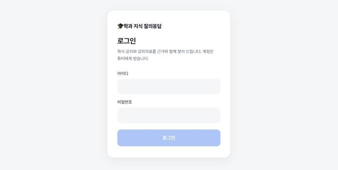
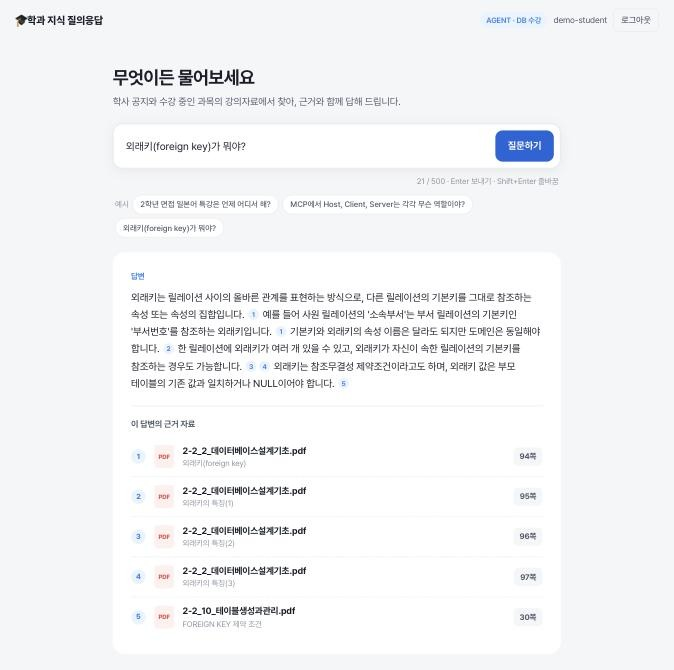
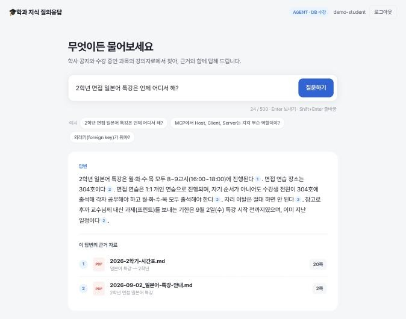
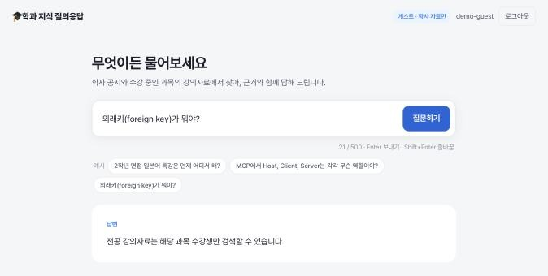

# dept-rag-agent

학과 지식 질의응답 AI 에이전트 — 학생이 질문하면 의도를 분석해 전공자료와 학사·공지자료 중 알맞은 쪽을 검색하고, 근거 출처와 함께 답변하는 서비스.

제27기 백호 튜터링 · ITogether 팀

## 접속

**https://3-104-10-86.sslip.io** — AWS EC2(시드니)에 배포. 서버는 비용 때문에 **테스트·시연할 때만 켭니다**(꺼져 있으면 접속되지 않음). 회원가입은 없고, 계정과 수강 과목은 관리자가 서버에서 만듭니다.

## 주요 화면

| 로그인 | 수강생 — 전공 질문 |
|---|---|
|  |  |
| 외부 주소로 접속한 로그인 화면 | 답 아래 근거 자료(파일명·절·쪽수)와 본문 번호 배지가 일치 |
| **수강생 — 학사 질문** | **게스트 — 같은 전공 질문** |
|  |  |
| 질문 의도에 따라 학사·공지 자료로 답변 | 전공 자료 없이 "수강생만 검색 가능" 안내 — 권한 두 겹이 화면에서 보이는 모습 |

## 아키텍처

```
학생 질문 → AI Agent(의도 분석/라우터) → MCP 도구 선택
                                              ├─ 전공자료 검색 (수강생 한정)
                                              └─ 학사·공지자료 검색 (전체 공개)
                                                        │
                              근거 출처(파일명·페이지) 표시 → 답변 생성
```

설계 원칙:
1. RAG 파이프라인은 하나, 색인만 전공용/학사용 2종으로 분리
2. 1주차는 워크플로우로 시작 → 6주차에 에이전트로 확장 (의도 분석·답변 생성만 LLM, 나머지는 코드)
3. 권한은 두 겹 — 도구 목록 노출 필터(비용 절감) + 검색 조회 필터(실제 방어선)

## 기술 스택

Python 3.12 · FastAPI · MCP · Claude API · OpenAI 임베딩 · PostgreSQL+pgvector · React+Vite · Docker · AWS EC2(CloudFormation) · Caddy(HTTPS)

버전과 선정 근거는 [`docs/harness/profile.md`](docs/harness/profile.md), 의존성 원본은 [`docs/sot.md`](docs/sot.md)를 봅니다.

## 디렉터리 구조

```
backend/        FastAPI 백엔드 + MCP 서버
  app/
    api/        라우터 (질문 엔드포인트 등)
    core/       설정, 라우팅/의도분석 로직
    db/         DB 세션, pgvector 스키마
    mcp/        MCP 도구 정의 (전공자료 검색 / 학사자료 검색)
  tests/        pytest
frontend/       React + Vite 프론트엔드
docker/         docker-compose(로컬·운영), Dockerfile, Caddyfile
infra/          AWS 스택 설계도(stack.yaml), 배포·색인 복원 스크립트
eval/           평가 문항 36개와 채점 가이드
docs/           요구사항 정의서, 구조도, 하네스(sot.md, adr/, harness/)
til/{이름}/     팀원별 학습 기록 (매주 1편 이상)
```

## 로컬 개발 환경 세팅

필요: Python 3.12, [uv](https://docs.astral.sh/uv/), Node 20.19+, Docker

```bash
make setup                                           # backend/.venv(3.12) + frontend 의존성
docker compose -f docker/docker-compose.yml up -d    # DB (PostgreSQL + pgvector)
cd backend && .venv/bin/uvicorn app.main:app --reload
cd frontend && npm run dev                            # 화면 http://localhost:5173 (/api는 :8000으로 프록시)
make check                                           # 커밋 전 검증 (CI와 동일)
```

화면과 API를 한 컨테이너로 확인하려면 `make app-up` → http://localhost:8080 (`make smoke URL=http://localhost:8080`). 비밀값은 저장소 루트 `.env`에서 실행 시 주입되며 이미지에는 들어가지 않습니다.

명령 전체와 작업 규칙은 [`AGENTS.md`](AGENTS.md)에 있습니다.

## 배포

서버 자원은 CloudFormation 설계도 [`infra/stack.yaml`](infra/stack.yaml) 하나로 만들고, `infra/deploy.sh <IP> <도메인>`으로 현재 커밋을 올립니다. 인터넷에 여는 문은 Caddy(80·443)뿐이고 앱·DB 포트는 공개하지 않습니다. 순서·비밀값·서버 켜고 끄기는 [`docs/dev-notes/deploy.md`](docs/dev-notes/deploy.md)에 있습니다.

## 권한

전공 강의자료는 해당 과목 수강생만, 학사·공지자료는 모든 학생이 봅니다. 도구 목록에서 숨기기(겹 1)와 검색 조건으로 다시 거르기(겹 2) 두 겹으로 막고, 모델에는 역할·수강 과목을 알려 주지 않습니다. 정책·위협·테스트 행렬은 [`docs/design/permissions.md`](docs/design/permissions.md)(완성본)에 있습니다.

## 정확도

평가 문항 36개(전공 15·학사 12·둘 다 3·자료에 없는 질문 6)를 3주차에 잠그고, 같은 시험지·같은 채점 기준으로 비교했습니다. 전체 표: [`docs/generated/eval-comparison.md`](docs/generated/eval-comparison.md)

| 측정 | 방식 | 답변 정확도 | 의도 분류 | 정답 자료 검색 |
|---|---|---|---|---|
| 3주차 기준선 | 보이는 도구 모두 검색 | 91.7% | — | 90.0% |
| 4주차 | 안내 데스크(질문 분류 → 도구 선택) | 91.7% | 86.1% | 90.0% |
| 7주차 | 안내 데스크 | 91.7% | 86.1% | 90.0% |
| 7주차 | Agent Loop(모델이 도구 선택·재검색) | 94.4% | — | 86.7% |

4주차 안내 데스크는 정확도를 유지하면서 도구 호출을 72회 → 38회로 줄였습니다. Agent Loop의 94.4%는 6주차(91.7%)보다 한 문항 차이라 개선으로 단정하지 않습니다.

## TIL 규칙

`til/{이름}/{YYYY-MM-DD}.md` 형식으로 매주 1편 이상 작성 후 커밋. 규칙을 어기면 `make check`가 실패합니다.

## 튜티용: 내려받기와 TIL 올리기

코드를 실행할 필요는 없습니다. TIL만 올리면 됩니다. 작성 형식은 [`til/_example.md`](til/_example.md)를 참고하세요.

**방법 1 — GitHub 웹에서 바로 (설치 없음, 1학년 추천)**

1. 저장소의 `til/{내 이름}/` 폴더로 이동
2. **Add file → Create new file** → 파일 이름을 `2026-10-01.md`처럼 날짜로 입력
3. 내용 작성 후 **Commit changes**

**방법 2 — 내 컴퓨터로 내려받아서**

```bash
git clone https://github.com/ias-kim/dept-rag-agent.git   # 처음 한 번
cd dept-rag-agent
git pull                                                  # 작성 전에 항상 최신으로
# til/{내 이름}/YYYY-MM-DD.md 작성
git add til/
git commit -m "docs(til): 홍길동 2026-10-01"
git push
```

`git push`가 거절되면 `git pull` 후 다시 `git push` 하세요. 다른 사람의 TIL이 먼저 올라온 경우입니다.

## 팀

| 학년 | 이름 | 역할 |
|---|---|---|
| 3학년(튜터) | 김성관 | 라우터, MCP 도구 노출, 권한 분리, 배포 |
| 2학년 | 이가을, 서정진 | MCP 서버·클라이언트 구조 학습 → 검색 도구 구현, 배포 연동 |
| 1학년 | 최나원, 홍유정 | Python 기초 → RAG·MCP 개념, 자료 정리 스크립트 |
